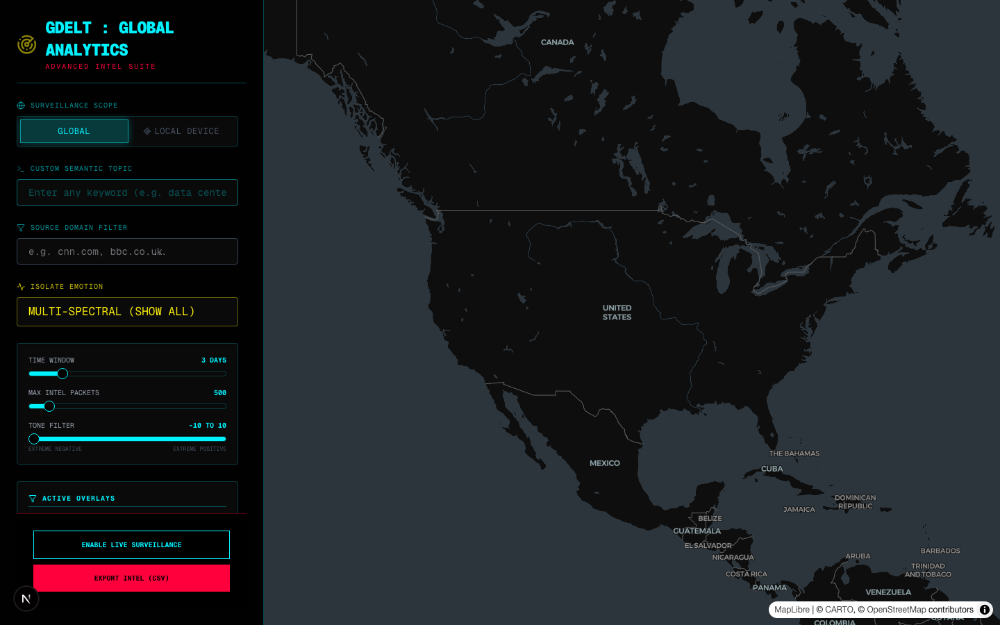
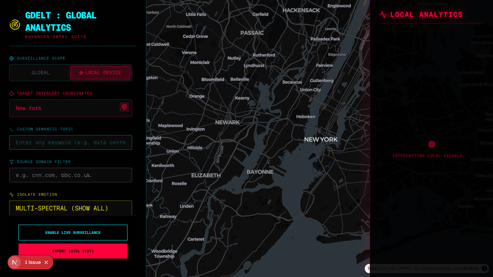
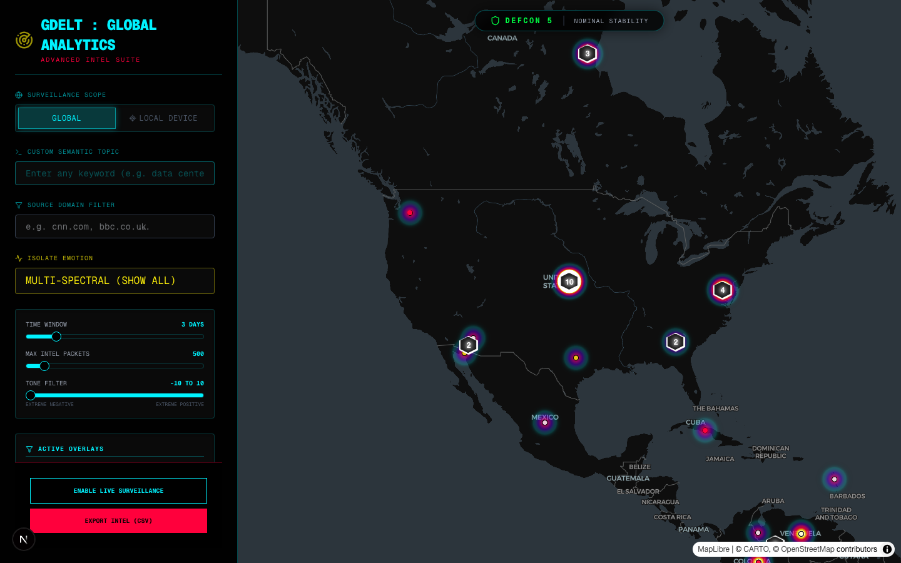

# GDELT Analysis Suite


A high-performance, real-time intelligence dashboard that processes the global GDELT Project (Global Database of Events, Language, and Tone) feed. Built with a robust Python/FastAPI data pipeline and a reactive Next.js map rendering engine.

## 🚀 Features

- **Global & Local Surveillance Modes:** Monitor global planetary-scale unrest, or lock onto a specific city (using your device's geolocation or manual input) to track hyper-local incidents.
- **Deep Semantic Emotion Analysis:** Extends standard GDELT V2Tone data with custom lexical heuristics to classify intelligence into 5 dominant emotional profiles (Anger, Fear, Sadness, Happiness, Neutral).
- **Temporal Scrubbing & Playback:** Scrub through chronological event timelines, or hit **Play** to automatically watch global crises unfold across the map over several days.
- **Semantic Cloud Intelligence:** A dynamic neon word cloud that extracts and scales the top topics (V2Themes) currently dominating the global wire.
- **Live Mode:** Pings the Google BigQuery API on a 5-minute interval, perfectly aligning with GDELT's publishing schedule to fetch data the second it's released.
- **Data Exporting:** Instantly download the actively filtered surveillance feed to JSON or CSV for offline GIS systems like Palantir or Maltego.

---

## 💻 Installation

### Option 1: Quick Auto-Installer (Mac / Linux)

For the easiest setup, simply run the included auto-installer script from your terminal:

```bash
chmod +x install.sh
./install.sh
```

This script will:
1. Ensure Node.js and Python 3 are installed.
2. Create an isolated Python virtual environment (`venv`).
3. Install all necessary `pip` and `npm` dependencies.
4. Guide you through Google Cloud Authentication.

### Option 2: Manual Installation

If you prefer to install it manually:

**1. Python Backend**
```bash
cd backend
python3 -m venv venv
source venv/bin/activate
pip install -r requirements.txt
```

**2. Node.js Frontend**
```bash
cd frontend
npm install
```

---

## ☁️ Google Cloud Setup (REQUIRED)

This suite interfaces directly with the GDELT Project's massive 3+ Terabyte public database hosted on Google BigQuery. To run queries, you **MUST** have a Google Cloud Project with the BigQuery API enabled.

1. **Create a Project:** Go to the [Google Cloud Console](https://console.cloud.google.com/) and create a new project.
2. **Enable BigQuery:** Search for "BigQuery API" and click **Enable**.
3. **Install the `gcloud` CLI:** If you haven't already, install the [Google Cloud CLI](https://cloud.google.com/sdk/docs/install).
4. **Authenticate Your Machine:** Run the following command in your terminal and log in with your Google account:
   ```bash
   gcloud auth application-default login
   ```
5. **Update the Project ID:** Open `backend/main.py` and modify line 35 to match your newly created Project ID:
   ```python
   client = bigquery.Client(project="YOUR_PROJECT_ID_HERE")
   ```

*Note: The backend has a hardcoded `maximum_bytes_billed` guard of 5GB per query to strictly prevent any accidental quota overages.*

---

## 🏃‍♂️ Running the Suite

You can launch both the frontend and backend simultaneously using the included runner script:

```bash
chmod +x run.sh
./run.sh
```

Alternatively, you can run them manually in separate terminal windows:
- **Backend:** `cd backend && source venv/bin/activate && uvicorn main:app --reload --port 8000`
- **Frontend:** `cd frontend && npm run dev`

Access the UI at: **http://localhost:3000**

---

## 🎛️ Operational Modes

### Filter Arrays
Use the left sidebar to dial in your target parameters. You can filter the raw wire by Theme (e.g. `PROTEST`), Emotion, Source Domain (e.g. `bbc.com`), and Lexical Tone limits.

### Temporal Playback
By default, the slider at the bottom covers 3 days of intel. Drag the slider thumb to slice the data by specific days. Press the **Play** button on the left to initiate chronological playback. The MapLibre engine will dynamically mount and unmount heatmaps to visualize the spread of events.

### Live Surveillance
Activate the red **Enable Live Surveillance** button to enter active tracking. The emotional heatmaps will physically pulse on your screen every 6.3 seconds to signify the active radar hook, and the backend will ping BigQuery precisely every 5 minutes to intercept new intel.

---

### Screenshots

**Global Emotion Heatmaps**


**Local City Scope**


**Semantic Cloud Intelligence**

